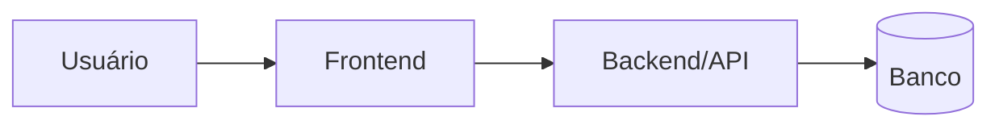

# Arquitetura

> Mantido pelo agente `docs`. Atualizado a cada feature que cria módulo, fluxo ou fronteira nova.

## Visão geral
<1 parágrafo: o que o sistema faz e as grandes peças.>

## Backend
<módulos, responsabilidades, padrão de erro/validação, autenticação>

## Frontend
<estrutura de páginas/componentes, estado, chamada à API>

## Dados
<entidades centrais e relações, ferramenta de migration>

## Infra e ambientes
<local, staging, produção; variáveis; como fazer deploy>

## Decisões relevantes
Ver [`docs/adr/`](adr/README.md).
